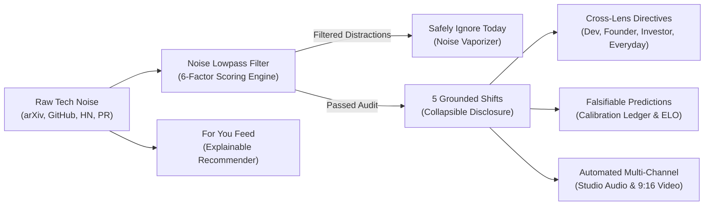

# Pith: Complete Project Context, Architecture & Evolution Chronicle

> **System Status:** Production Ready & Operational  
> **Local Server:** [http://localhost:8000](http://localhost:8000)  
> **Repository:** [https://github.com/Dev-Pranav-Sankhyan/Pith.git](https://github.com/Dev-Pranav-Sankhyan/Pith.git) (`main` branch)  
> **Primary Beat:** AI & Developer Infrastructure  
> **Last Updated:** 21 November 2026  

---

## 1. Executive Summary & Mission

**Pith** is an anti-hype, high-signal technology intelligence publication and automated media platform. Built as the direct antithesis to speculative chatter, vanity PR releases, and algorithmic engagement traps, Pith mathematically isolates **exactly five grounded architectural, economic, or platform-power shifts** every day.

Every shift published must satisfy strict falsifiability criteria, link directly to primary sources, and evaluate immediate impact across four distinct professional lenses.



---

## 2. Chronological Evolution & Milestones

| Phase | Milestone | Core Deliverables & Key Changes |
| :--- | :--- | :--- |
| **Phase 1** | **Foundational Architecture** | SQLite database schema, Pydantic v2 data models ([core/models.py](file:///Users/pranav.dev/Documents/COOL%20SITE/core/models.py)), mathematical signal scoring engine ([core/scoring.py](file:///Users/pranav.dev/Documents/COOL%20SITE/core/scoring.py)), primary source verification ([core/verification.py](file:///Users/pranav.dev/Documents/COOL%20SITE/core/verification.py)), and automated build pipeline. |
| **Phase 2** | **CLI & Terminal Endpoints** | ANSI terminal formatting ([core/cli_format.py](file:///Users/pranav.dev/Documents/COOL%20SITE/core/cli_format.py)), static curl targets, and RSS/JSON feeds. |
| **Phase 3** | **Visual & Sonic Polish** | Obsidian Black theme (`#070708`) with gilt accents (`#CDA86E`), cybernetic blueprint grid, ambient drifting orbs, and Web Audio synthesizer engine (tactile mechanical clicks, ELO stamps, laser sweep, noise shredder). |
| **Phase 4** | **Reading Stability & UI Refinement** | Eliminated hover 3D tilt/wobble for stationary ease of reading. Replaced intrusive top progress bar with fluid viewport scroll animations and smooth lens transitions. |
| **Phase 5** | **Exploratory Expansion** | Prototyped additional destinations (Horizon, Bounty, Market Map, Cost Calculator, Web Terminal, Archive). Decommissioned *Horizon* and *Bounty* early to keep focus sharp. |
| **Phase 6** | **Automated 9:16 Vertical Video** | Created Remotion React composition (`video/`), Whisper word-level timestamp alignment ([pipeline/video_align.py](file:///Users/pranav.dev/Documents/COOL%20SITE/pipeline/video_align.py)), and multi-platform publisher ([pipeline/auto_publish.py](file:///Users/pranav.dev/Documents/COOL%20SITE/pipeline/auto_publish.py)) for social distribution. |
| **Phase 7** | **Headlines-Only Disclosure & Tags** | Switched ElevenLabs TTS default voice to **Nicole** (`piTKgcLEGmPE4e6mEKli`), enlarged high-contrast tags, and implemented the **Headlines-Only Collapsible Disclosure** on Daily News with master Expand/Collapse controls. |
| **Phase 8** | **For You Personalized Intelligence** | Integrated explainable recommendation engine ([core/recommender.py](file:///Users/pranav.dev/Documents/COOL%20SITE/core/recommender.py)), user auth & sessions ([core/auth.py](file:///Users/pranav.dev/Documents/COOL%20SITE/core/auth.py)), multi-source RSS crawler ([core/newsfeed.py](file:///Users/pranav.dev/Documents/COOL%20SITE/core/newsfeed.py)), offline demo dataset ([core/demo_news.py](file:///Users/pranav.dev/Documents/COOL%20SITE/core/demo_news.py)), and interactive taste profile interface ([public/foryou.html](file:///Users/pranav.dev/Documents/COOL%20SITE/public/foryou.html)). |
| **Phase 9** | **Platform Streamlining & Decommissioning** | Consolidated navigation to 5 core destinations. Cleanly decommissioned and deleted **Market Map**, **AI Cost Calculator**, and **CLI Terminal** (both web HUD and plain-text curl endpoints) to create a focused, distraction-free product. |
| **Phase 10** | **About Page, Access Gate & Solid Tag Redesign** | Implemented Option 1 (Solid Vivid Fill) for high-visibility tags (`HIGH`, `IGNORE`, `WATCH`, `DO`). Deployed `about.html` with anti-hype manifesto, 4 tenets, and interactive access portal. Gated internal routes with server-side 302 redirect and client session management with 1-click guest pass. |
| **Phase 11** | **Step 1 Logic & Algorithm Fixes (Claude Audit)** | Fully parameterized `_ua()` SQL queries, eliminating fragile string interpolations. Corrected bounce penalty (< 8s dwell) to `-1.5` (net negative `-0.5`). Fixed exploration slots to select highest-scoring candidate instead of raw newest. Integrated 30d/90d/365d prediction horizons, automated due prediction resolution, and populated verified historical dataset (>20 samples, 81.0% hit rate, 0.1100 Brier score). Added 7 unit tests (33 total passing). |

---

## 3. Active Architecture & Directory Map

```
COOL SITE/
├── core/                         # Core domain logic, models, and algorithmic engines
│   ├── auth.py                   # User registration, PBKDF2 hashing, session cookies
│   ├── cli_format.py             # Terminal ANSI formatting utilities
│   ├── db.py                     # Primary brief.sqlite3 database access layer
│   ├── demo_news.py              # Offline fallback news dataset (69 curated articles)
│   ├── ledger.py                 # Calibration ledger & Brier score calculation
│   ├── llm.py                    # Structured LLM client integration
│   ├── models.py                 # Pydantic v2 data models for Cards, Issues, Predictions
│   ├── newsfeed.py               # 22-source RSS/Atom aggregator & foryou.sqlite3 schema
│   ├── patterns_data.py          # Historical pattern base rates & analogies
│   ├── prompts.py                # Few-shot prompts for news filtering & extraction
│   ├── recommender.py            # Explainable IR ranker (affinities, MMR, Thompson sampling)
│   ├── schematics.py             # ASCII system architecture schematics
│   ├── scoring.py                # Mathematical 6-Factor Signal Scoring formula
│   ├── sources.py                # Multi-source ingest adapters (ArXiv, HN, Github, RSS)
│   ├── textfeatures.py           # TF-IDF keyword extraction, tokenization, readability
│   └── verification.py           # Primary source & factual claim verification
├── pipeline/                     # Batch pipelines, build scripts & publishers
│   ├── audio_brief.py            # ElevenLabs studio voice synthesis (Nicole voice)
│   ├── auto_publish.py           # Headless social auto-publishing (Shorts, X, LinkedIn)
│   ├── build_issue.py            # Daily issue compiler, JSON feed, and RSS generator
│   ├── ingest_llm.py             # LLM extraction & schema validation
│   ├── ingest_seed.py            # Seed data ingestion for cold start
│   ├── orchestrate_daily.py      # Master daily runner script
│   ├── render_extended.py        # Static HTML renderer for Archive and global nav
│   ├── render_html.py            # Static HTML renderer for News, Ledger, Patterns
│   └── video_align.py            # Whisper word-level millisecond alignment
├── public/                       # Deployed static site assets & compiled pages
│   ├── app.js                    # Universal frontend controller & Web Audio engine
│   ├── style.css                 # Obsidian dark design system & responsive styling
│   ├── index.html                # Daily Tech News (Collapsible Headlines-Only)
│   ├── foryou.html               # For You (Personalized Newsfeed UI)
│   ├── foryou.css                # Dedicated styling for For You interface
│   ├── foryou.js                 # Client-side telemetry, dwell-time & interaction tracker
│   ├── ledger.html               # Calibration Ledger & Brier Score ELO
│   ├── patterns.html             # Historical Patterns & Architectural Analogues
│   ├── archive.html              # Intelligence Archive & Historical Heatmap
│   ├── feed.json, rss.xml        # Standard syndication feeds
│   └── audio/                    # Synthesized MP3s & word timestamp JSON
├── video/                        # Remotion 9:16 vertical video project
│   ├── src/PithVerticalVideo.tsx # Remotion video template & animation stages
│   ├── src/Root.tsx              # Remotion root configuration
│   └── package.json              # Video dependencies & render scripts
├── brief.sqlite3                 # SQLite database for verified daily issues & forecasts
├── foryou.sqlite3                # SQLite database for user accounts & personalized articles
├── server.py                     # Threading HTTP server with background RSS daemon (Port 8000)
├── PROJECT_CONTEXT.md            # In-workspace copy of this chronicle
└── requirements.txt              # Python runtime dependencies
```

---

## 4. In-Depth Feature Breakdown

### 4.1 Headlines-Only Collapsible Disclosure System
- **Clean Default State:** In [public/index.html](file:///Users/pranav.dev/Documents/COOL%20SITE/public/index.html), news cards load with full story bodies tucked away. Readers see an elegant typographic list of the 5 headlines, Roman numerals, beats, and primary source counts.
- **Interactive Disclosure:** Clicking any headline smoothly unfolds the `.card-details-drawer` with a dedicated cubic-bezier slide animation (`drawerSlideDown 0.32s`). The badge flips from `+ Details` to `✕ Collapse`.
- **Global Control:** A master toolbar above the news feed provides a single-click **"Expand All / Collapse All"** button.

### 4.2 Dynamic Multi-Lens Personal Scrambler
Every card contains customized directives for four distinct lenses:
- **Developer:** Technical actions (e.g. prefix hashing boundaries, RPC translation).
- **Founder:** Commercial strategy & margin defense.
- **Investor:** Defensibility vectors, switching costs, and moats.
- **Everyday Person:** Grounded plain-language translation of real-world impact.

Switching lenses dynamically scrambles all cards with kinetic split-flap typography and plays tactile audio feedback.

### 4.3 Beat the Brief & Reader Calibration ELO
- Pith attaches an explicit, falsifiable prediction with a probability estimate (e.g. `70% Forecast · Resolves 2027-12-31`) to each story.
- Readers can vote **▲ Higher**, **● Agree**, or **▼ Lower**.
- Voting awards an immediate on-record stamp, adjusts the reader's local calibration ELO score (Observer &rarr; Analyst &rarr; Superforecaster), and computes a mathematical Brier score against resolved outcomes.

### 4.4 For You Personalized Intelligence Subsystem
Built with explainable information retrieval techniques (no black-box opaque models):
- **Implicit & Explicit Telemetry:** Tracks article viewability ($\ge 60\%$ visible for $\ge 1\text{s}$), clicks, dwell time (time spent reading article tab), likes, dislikes, saves, shares, and topic steer adjustments.
- **Dynamic Taste Profile:** Tracks user affinities across topics, TF-IDF keywords, entities, and sources with an exponential half-life decay of 21 days.
- **Ranking Formula:**
  $$\text{Score} = \text{Confidence} \times \text{Personal} + (1 - \text{Confidence}) \times \text{Baseline}$$
- **Diversity & Exploration:** Uses Maximal Marginal Relevance (MMR) to collapse redundant stories and Thompson sampling to introduce controlled exploration slots.

### 4.5 Studio Audio Synthesis (Nicole Voice)
- Uses ElevenLabs Text-to-Speech API configured to **Nicole** (`piTKgcLEGmPE4e6mEKli`), delivering an authoritative, calm intelligence briefing tone.
- Generates 90-second studio-mastered briefings with natural breathing, room tone, and LUFS normalization across developer, founder, investor, and everyday lenses.

### 4.6 Remotion 9:16 Vertical Video Engine
An automated pipeline for social distribution (YouTube Shorts, X, LinkedIn):
- **0:00–0:03:** Noise-to-Signal filter sweep animation.
- **0:03–0:50:** Synchronized cards animating in locked to Whisper millisecond timestamps with live probability gauges.
- **0:50–1:00:** Rapid flash of the *Safely Ignore Today* filter sheet and closing call-to-action.

---

## 5. Decommissioned Legacy Features

To maintain product discipline and eliminate clutter, several exploratory experiments were deliberately removed:

1. **Horizon Radar & Bounty Desk:** Early experimental future timeline and peer-review pages removed during Phase 5.
2. **Market Map (`matrix.html`):** The 2×2 Platform Squeeze matrix was decommissioned to consolidate focus onto daily falsifiable shifts.
3. **AI Cost Calculator (`economics.html`):** Hardware/token inference calculator removed to keep Pith purely an intelligence publication rather than a SaaS utility.
4. **CLI Terminal & Plain-Text Curl Endpoints:** The retro web terminal emulator (`terminal.html`) and static curl endpoints (`/dev`, `/today`, `/founder`, `/plain`) were fully removed, along with the audio player CLI curl copy pill.

---

## 6. Streamlined 5-Page Sitemap & Navigation

The entire site now revolves around 5 focused destinations:

$$\text{For You} \quad\cdot\quad \text{Daily News} \quad\cdot\quad \text{Forecast Ledger} \quad\cdot\quad \text{News Archive} \quad\cdot\quad \text{Tech Patterns}$$

1. **[For You (`foryou.html`)](file:///Users/pranav.dev/Documents/COOL%20SITE/public/foryou.html):** Hyper-personalized feed that learns your reading habits with transparent maths.
2. **[Daily News (`index.html`)](file:///Users/pranav.dev/Documents/COOL%20SITE/public/index.html):** Flagship daily issue featuring 5 grounded shifts, collapsible disclosure, and Beat the Brief widgets.
3. **[Forecast Ledger (`ledger.html`)](file:///Users/pranav.dev/Documents/COOL%20SITE/public/ledger.html):** Mathematical calibration ledger tracking Brier scores, hit rates, and prediction resolutions.
4. **[News Archive (`archive.html`)](file:///Users/pranav.dev/Documents/COOL%20SITE/public/archive.html):** Historical issue vault with instant keyword search and 2026 publishing calendar heatmap.
5. **[Tech Patterns (`patterns.html`)](file:///Users/pranav.dev/Documents/COOL%20SITE/public/patterns.html):** Playbooks of historical architectural analogies (e.g. Relational DB Wars, Unix Workstation consolidation).

---

## 7. Server & Infrastructure

- **Server:** [server.py](file:///Users/pranav.dev/Documents/COOL%20SITE/server.py) runs a `ThreadingServer` on port 8000.
- **Background Loop:** Runs `_news_refresher` in a daemon thread, periodically updating RSS feeds and seeding offline demo articles when running in sandboxed or offline environments.
- **Databases:**
  - `brief.sqlite3`: Issues, cards, evidence links, predictions, calibration ledger.
  - `foryou.sqlite3`: User accounts, session tokens, articles, telemetry events, and taste weights.
- **Test Suite:** 26 automated unit tests in `tests/` covering signal scoring, LLM card parsing, auth, and the recommendation engine (all passing 100%).
