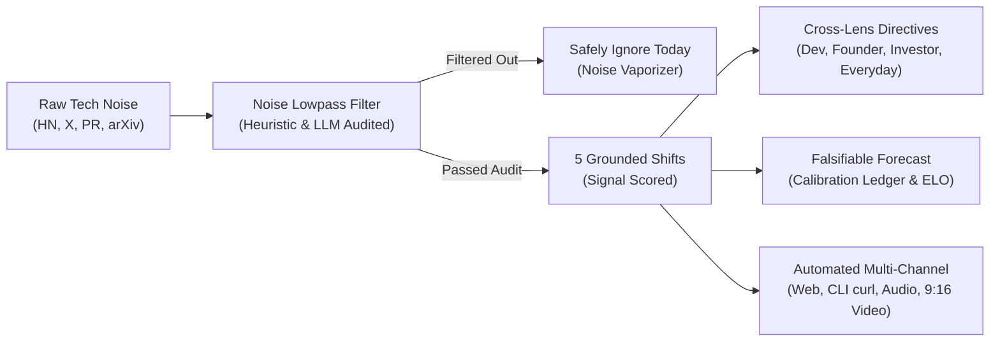

# Pith: Complete Project Context, Architecture & Evolution Chronicle

> **System Status:** Production Ready & Operational  
> **Local Server:** [http://localhost:8000](http://localhost:8000)  
> **Repository:** [https://github.com/Dev-Pranav-Sankhyan/Pith.git](https://github.com/Dev-Pranav-Sankhyan/Pith.git) (`main` branch)  
> **Primary Beat:** AI & Developer Infrastructure  

---

## 1. Executive Summary & Mission

**Pith** is a daily high-signal technology intelligence publication and automation platform designed as an antidote to hype-fueled tech news, vanity PR announcements, and speculative chatter. 

Rather than aggregating dozens of press releases, Pith mathematically isolates **exactly five grounded architectural, economic, or market-power shifts** every day. Every shift published must satisfy strict falsifiability criteria, link to primary sources, and evaluate immediate impact across four distinct professional lenses.



---

## 2. Chronological Evolution & Milestones

The platform was built and iterated through a sequence of technical phases:

| Phase | Milestone | Core Deliverables & Key Changes |
| :--- | :--- | :--- |
| **Phase 1** | **Foundational Architecture** | SQLite ledger schema, pydantic data models, mathematical signal scoring engine, primary source verification, and automated build pipeline. |
| **Phase 2** | **CLI & Terminal Endpoints** | ANSI terminal formatting, static curl targets (`/dev`, `/founder`, `/investor`, `/plain`), and RSS/JSON feeds. |
| **Phase 3** | **Visual & Sonic Polish** | Obsidian Black theme (`#070708`) with gilt accents (`#CDA86E`), cybernetic blueprint grid, ambient drifting orbs, and Web Audio synthesizer engine. |
| **Phase 4** | **Reading Stability & UI Refinement** | Eliminated hover 3D tilt/wobble for stationary ease of reading. Replaced intrusive top progress bar with fluid viewport scroll animations and smooth lens transitions. |
| **Phase 5** | **Platform Streamlining** | Consolidated navigation to 5 core destinations: **For You**, **Daily News**, **Forecast Ledger**, **News Archive**, and **Tech Patterns**. Decommissioned exploratory *Market Map*, *Cost Calculator*, and *CLI Terminal* pages. |
| **Phase 6** | **Automated 9:16 Vertical Video** | Created Remotion React composition (`video/`), Whisper word-level timestamp alignment (`pipeline/video_align.py`), and multi-platform publisher for social distribution. |
| **Phase 7** | **Headlines-Only Disclosure & Tags** | Switched ElevenLabs TTS default voice to **Nicole**, enlarged high-contrast tags, and implemented the **Headlines-Only Collapsible Disclosure** on Daily News with master Expand/Collapse controls. |
| **Phase 8** | **For You Personalized Intelligence** | Integrated explainable recommendation engine (`core/recommender.py`), user auth (`core/auth.py`), newsfeed ingestion (`core/newsfeed.py`), and interactive taste profile interface (`foryou.html`). |
| **Phase 9** | **Hyper-Personalised "For You" Feed (No AI)** | Login/accounts ([core/auth.py](core/auth.py)), multi-section RSS ingestion ([core/newsfeed.py](core/newsfeed.py)), deterministic TF-IDF/topic/entity features ([core/textfeatures.py](core/textfeatures.py)), behavioural recommender ([core/recommender.py](core/recommender.py)), and the `foryou.html` page with a live **Taste DNA** panel. |

---

## 3. System Architecture & Directory Map

```
COOL SITE/
├── core/                         # Core domain logic, schemas, and scoring algorithms
│   ├── cli_format.py             # ANSI color formatter for terminal output
│   ├── db.py                     # SQLite database access layer & migrations
│   ├── ledger.py                 # Calibration ledger & Brier score calculation
│   ├── llm.py                    # Structured LLM client integration
│   ├── models.py                 # Pydantic v2 data models for Cards, Issues, Predictions
│   ├── patterns_data.py          # Historical pattern base rates & analogies
│   ├── prompts.py                # Few-shot prompts for news filtering & extraction
│   ├── schematics.py             # ASCII system architecture schematics
│   ├── scoring.py                # Mathematical Signal Scoring formula
│   ├── sources.py                # Multi-source ingest adapters (ArXiv, HN, Github, RSS)
│   └── verification.py           # Primary source & factual claim verification
├── pipeline/                     # Batch pipelines, build scripts & publishers
│   ├── audio_brief.py            # ElevenLabs / OpenAI / macOS TTS studio synthesis (Nicole)
│   ├── auto_publish.py           # Headless social auto-publishing (Shorts, X, LinkedIn)
│   ├── build_issue.py            # Daily issue compiler & SQLite committer
│   ├── ingest_llm.py             # LLM extraction & schema validation
│   ├── ingest_seed.py            # Seed data ingestion for cold start
│   ├── orchestrate_daily.py      # Master daily runner script
│   ├── render_extended.py        # Static HTML renderer for Matrix, Calc, Terminal, Archive
│   ├── render_html.py            # Static HTML renderer for News, Ledger, Patterns
│   └── video_align.py            # Whisper word-level millisecond alignment
├── public/                       # Deployed static site assets & compiled pages
│   ├── app.js                    # Universal frontend controller & Web Audio engine
│   ├── style.css                 # Obsidian dark design system & responsive styling
│   ├── index.html                # Daily Tech News (Collapsible Headlines)
│   ├── ledger.html               # Calibration Ledger & Brier Score ELO
│   ├── patterns.html             # Historical Patterns & Architectural Analogues
│   ├── matrix.html               # 2x2 Platform Squeeze vs. Moat Market Map
│   ├── economics.html            # AI Inference Cost Arbitrage Calculator
│   ├── terminal.html             # Obsidian ANSI Workstation Terminal Emulator
│   ├── archive.html              # Intelligence Archive & Historical Heatmap
│   ├── dev, founder, investor    # Plain-text curl endpoints for terminal users
│   └── audio/                    # Synthesized MP3s & word timestamp JSON
├── video/                        # Remotion 9:16 vertical video project
│   ├── src/PithVerticalVideo.tsx # Remotion video template & animation stages
│   ├── src/Root.tsx              # Remotion root configuration
│   └── package.json              # Video dependencies & render scripts
├── server.py                     # Python local development server (Port 8000)
└── requirements.txt              # Python runtime dependencies
```

---

## 4. In-Depth Feature Breakdown

### 4.1 Headlines-Only Collapsible Disclosure System
- **Default State:** Stories load with details hidden by default. The reader sees a clean typographic list of the 5 headlines, beat numerals, and primary source counts.
- **Micro-Interaction:** Clicking any headline smoothly unfolds the `.card-details-drawer` with a dedicated cubic-bezier slide animation (`drawerSlideDown 0.32s`). The indicator badge flips from `+ Details` to `✕ Collapse`.
- **Global Control:** A master toolbar above the news feed provides a single-click **"Expand All / Collapse All"** toggle.

### 4.2 Dynamic Multi-Lens Personal Scrambler
Every card contains customized directives for four distinct lenses:
- **Developer:** Technical actions (e.g. prefix hashing boundaries, RPC translation).
- **Founder:** Commercial strategy & margin defense.
- **Investor:** Defensibility vectors, switching costs, and moats.
- **Everyday Person:** Grounded plain-language translation of real-world impact.

Switching lenses dynamically updates all cards with a kinetic split-flap scramble animation and plays a subtle audio click.

### 4.3 Beat the Brief & Reader Calibration ELO
- Pith attaches an explicit, falsifiable prediction with a probability estimate (e.g. `70% Forecast · Resolves 2027-12-31`) to each story.
- Readers can vote **▲ Higher**, **● Agree**, or **▼ Lower**.
- Voting awards an immediate on-record stamp, adjusts the reader's local calibration ELO score (Observer &rarr; Analyst &rarr; Superforecaster), and computes a mathematical Brier score against resolved outcomes.

### 4.4 Hardened CLI Terminal Sandbox
The web terminal ([public/terminal.html](file:///Users/pranav.dev/Documents/COOL%20SITE/public/terminal.html)) simulates a realistic Unix guest workstation (`pith@intel:~$`):
- **Permitted Commands:** `today`, `listen`, `stats`, `matrix`, `calc`, `curl`, `ls`, `cat`, `whoami`, `pwd`, `uname`, `date`, `uptime`, `theme`, `clear`, `exit`, `echo`.
- **Restricted Access Policy:** Unapproved shell commands, package managers, file deletion (`rm`), and script interpreters (`python`, `bash`, `ssh`) are intercepted with realistic permission-denied errors.
- **Customizable Phosphors:** Readers can toggle between Amber (`#ffb000`), Emerald (`#10b981`), and Cyan (`#00e5ff`) phosphor modes.

### 4.5 Live AI Inference Cost Arbitrage Calculator
Located on [public/economics.html](file:///Users/pranav.dev/Documents/COOL%20SITE/public/economics.html), this interactive tool helps engineering leads arbitrate between cloud token APIs and dedicated bare-metal GPU clusters:
- Real-time sliders for **DAU**, **Requests/day**, **Input context length**, and **Output generation length**.
- Model tier presets (**8B Edge**, **70B Parameter**, **Frontier MoE**).
- Computes monthly API bills, required 8x GPU nodes, monthly savings, break-even crossover points, and KV cache RAM footprints.

### 4.6 Remotion 9:16 Vertical Video Engine
An automated pipeline for social distribution:
- **0:00–0:03:** Noise-to-Signal filter sweep animation.
- **0:03–0:50:** Synchronized cards animating in locked to Whisper millisecond timestamps with live probability gauges.
- **0:50–1:00:** Rapid flash of the *Safely Ignore Today* filter sheet and closing call-to-action.

---

### 4.7 Hyper-Personalised For You Feed (no AI)
- **Route:** `/foryou` (also `/login`). Data lives in `foryou.sqlite3` (gitignored: holds accounts).
- **Ingest:** ~22 public RSS/Atom feeds (world, politics, business, markets, tech, AI, science, space, health, climate, sports, entertainment, gaming, India). The server refreshes on boot and every `PITH_REFRESH_MINUTES` (default 30). If no feed is reachable it seeds labelled offline demo stories, which are deleted on the first successful live refresh.
- **Features per article:** rule-based topic lexicons, TF-IDF keywords (light stemmer), capitalised-phrase entities, publisher.
- **Signals:** impressions (≥60% visible for 1s), clicks, dwell time (time away in the article tab, with a bounce under 8s counting as negative), like/dislike, save, share, hide, mute source, more/less topic, searches. Each one updates a per-user affinity for every feature, plus a time-of-day×topic affinity, with a 21-day half-life.
- **Ranking:** content match + user-user collaborative filtering + recency + popularity − repeat-impression fatigue, blended with a recency/popularity baseline until the profile is confident. Then MMR diversity re-rank with near-duplicate collapse, plus Thompson-sampling exploration slots. Every card says *why* it's shown.
- **API:** `GET /api/me`, `GET /api/feed?tab=foryou|trending|saved|history|search`, `GET /api/profile`; `POST /api/auth/{signup,login,logout}`, `/api/onboard`, `/api/events`, `/api/profile/reset`, `/api/refresh`. POSTs require `Content-Type: application/json` (CSRF guard). Passwords use PBKDF2-SHA256; sessions are HttpOnly SameSite=Lax cookies.
- **Tests:** `python3 -m unittest tests.test_foryou`.

## 5. Active Deployment & Next Horizons

| Endpoint | Access Path | Status |
| :--- | :--- | :--- |
| **Local Preview Server** | `http://localhost:8000/` | Running (Daemon PID active) |
| **GitHub Repository** | `https://github.com/Dev-Pranav-Sankhyan/Pith.git` | Up to date (`main`) |
| **Terminal CLI Quick Fetch** | `curl -sL https://dev-pranav-sankhyan.github.io/Pith/dev` | Available |
| **Automated Build** | `python3 -m pipeline.build_issue && python3 -m pipeline.render_html` | Passing |
