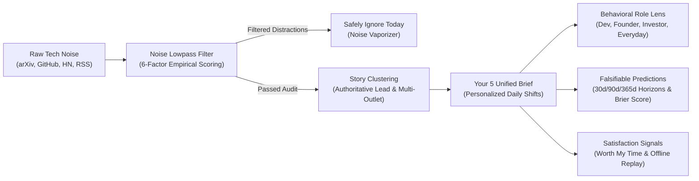

# Pith: Complete Project Context, Architecture & Evolution Chronicle

> **System Status:** Production Ready & Operational  
> **Local Server:** [http://localhost:8000](http://localhost:8000)  
> **Repository:** [https://github.com/Dev-Pranav-Sankhyan/Pith.git](https://github.com/Dev-Pranav-Sankhyan/Pith.git) (`main` branch)  
> **Primary Beat:** AI & Developer Infrastructure  
> **Last Updated:** 21 November 2026  

---

## 1. Executive Summary & Mission

**Pith** is an anti-hype, high-signal technology intelligence publication and automated media platform. Built as the direct antithesis to speculative chatter, vanity PR releases, and algorithmic engagement traps, Pith mathematically isolates **exactly five grounded architectural, economic, or platform-power shifts** every day.

Every shift published must satisfy strict falsifiability criteria, link directly to primary sources, and evaluate immediate impact across four distinct professional lenses.



---

## 2. Chronological Evolution & Milestones

| Phase | Milestone | Core Deliverables & Key Changes |
| :--- | :--- | :--- |
| **Phase 1** | **Foundational Architecture** | SQLite database schema, Pydantic v2 data models ([core/models.py](file:///Users/pranav.dev/Documents/COOL%20SITE/core/models.py)), mathematical signal scoring engine ([core/scoring.py](file:///Users/pranav.dev/Documents/COOL%20SITE/core/scoring.py)), primary source verification ([core/verification.py](file:///Users/pranav.dev/Documents/COOL%20SITE/core/verification.py)), and automated build pipeline. |
| **Phase 2** | **CLI & Terminal Endpoints** | ANSI terminal formatting ([core/cli_format.py](file:///Users/pranav.dev/Documents/COOL%20SITE/core/cli_format.py)), static curl targets, and RSS/JSON feeds. |
| **Phase 3** | **Visual & Sonic Polish** | Obsidian Black theme (`#070708`) with gilt accents (`#CDA86E`), cybernetic blueprint grid, ambient drifting orbs, and Web Audio synthesizer engine (tactile mechanical clicks, ELO stamps, laser sweep, noise shredder). |
| **Phase 4** | **Reading Stability & UI Refinement** | Eliminated hover 3D tilt/wobble for stationary ease of reading. Replaced intrusive top progress bar with fluid viewport scroll animations and smooth lens transitions. |
| **Phase 5** | **Exploratory Expansion** | Prototyped additional destinations (Horizon, Bounty, Market Map, Cost Calculator, Web Terminal, Archive). Decommissioned *Horizon* and *Bounty* early to keep focus sharp. |
| **Phase 6** | **Automated 9:16 Vertical Video** | Created Remotion React composition (`video/`), Whisper word-level timestamp alignment ([pipeline/video_align.py](file:///Users/pranav.dev/Documents/COOL%20SITE/pipeline/video_align.py)), and multi-platform publisher ([pipeline/auto_publish.py](file:///Users/pranav.dev/Documents/COOL%20SITE/pipeline/auto_publish.py)) for social distribution. |
| **Phase 7** | **Headlines-Only Disclosure & Tags** | Switched ElevenLabs TTS default voice to **Nicole** (`piTKgcLEGmPE4e6mEKli`), enlarged high-contrast tags, and implemented the **Headlines-Only Collapsible Disclosure** on Daily News with master Expand/Collapse controls. |
| **Phase 8** | **For You Personalized Intelligence** | Integrated explainable recommendation engine ([core/recommender.py](file:///Users/pranav.dev/Documents/COOL%20SITE/core/recommender.py)), user auth & sessions ([core/auth.py](file:///Users/pranav.dev/Documents/COOL%20SITE/core/auth.py)), multi-source RSS crawler ([core/newsfeed.py](file:///Users/pranav.dev/Documents/COOL%20SITE/core/newsfeed.py)), offline demo dataset ([core/demo_news.py](file:///Users/pranav.dev/Documents/COOL%20SITE/core/demo_news.py)), and interactive taste profile interface ([public/foryou.html](file:///Users/pranav.dev/Documents/COOL%20SITE/public/foryou.html)). |
| **Phase 9** | **Platform Streamlining & Decommissioning** | Consolidated navigation to 5 core destinations. Cleanly decommissioned and deleted **Market Map**, **AI Cost Calculator**, and **CLI Terminal** (both web HUD and plain-text curl endpoints) to create a focused, distraction-free product. |
| **Phase 10** | **About Page, Access Gate & Solid Tag Redesign** | Implemented Option 1 (Solid Vivid Fill: `#dc2626` crimson for `HIGH`, `#334155` slate for `IGNORE`) with 6px radius. Deployed `about.html` with anti-hype manifesto and interactive access portal. Gated internal routes with server-side 302 redirect and client session management with 1-click guest pass (narrowed to For You only in Phase 14). |
| **Phase 11** | **Step 1: Logic & Algorithm Fixes (Claude Audit)** | Fully parameterized `_ua()` SQL queries, eliminating fragile string interpolations. Corrected bounce penalty (< 8s dwell) to `-1.5` (net negative `-0.5`). Fixed exploration slots to select highest-scoring candidate instead of raw newest. Integrated 30d/90d/365d prediction horizons, automated due prediction resolution, and populated an example historical dataset (later re-labelled *illustrative* in Phase 14; it is not a real track record). Added 7 unit tests. |
| **Phase 12** | **Step 2: Story Clustering & Grounded Scoring** | Implemented deterministic clustering ([core/clustering.py](file:///Users/pranav.dev/Documents/COOL%20SITE/core/clustering.py)) grouping multi-outlet coverage by entity overlap, Jaccard title token similarity, and domain authority tiers (`arxiv.org`, `github.com`, etc.). Grounded 6-factor signal scoring ([core/scoring.py](file:///Users/pranav.dev/Documents/COOL%20SITE/core/scoring.py)) in measurable data (primary domain checks, regex extraction for pricing/APIs/ecosystem/fluff, and feedback weight tuning). Preserved full article text for feature extraction ([core/newsfeed.py](file:///Users/pranav.dev/Documents/COOL%20SITE/core/newsfeed.py)). Deduplicated story clusters in the feed and rendered source-diversity pills ([public/foryou.js](file:///Users/pranav.dev/Documents/COOL%20SITE/public/foryou.js)). Added 8 unit tests. |
| **Phase 13** | **Step 3: Unification of 'Your 5' & Offline Replay** | Merged Daily News and For You into **'Your 5'** ([core/your5.py](file:///Users/pranav.dev/Documents/COOL%20SITE/core/your5.py) & `/api/your5`). Implemented behavioral role inference (`infer_role`) defaulting the daily perspective (Developer, Founder, Investor, Everyday) based on active reading patterns. Added explicit satisfaction feedback (`worth_time: 3.5`, `not_worth_time: -3.0`) with interactive 1-tap buttons on story cards. Created weekly satisfaction & pattern digest (`/api/digest`). Built offline personalization evaluator ([core/eval_personalization.py](file:///Users/pranav.dev/Documents/COOL%20SITE/core/eval_personalization.py)) measuring Hit Rate @ 5, Hit Rate @ 10, MRR, and NDCG@10 against a recency-only baseline. Added 9 unit tests. Total test suite expanded to **50 passing unit tests**. |
| **Phase 14** | **Step 4: Honest Ledger, Public Brief & Backend Hardening** | Re-labelled the 21 hand-written seed predictions as `illustrative` (they had been shown as Pith's real track record) and excluded them from every score; Ledger now shows "No live forecast has resolved yet" until real resolutions exist, plus a Brier skill score vs base rate. Added an append-only `prediction_resolutions` log with a named reviewer and evidence, DB triggers that lock forecast fields after publication day, and a human-in-the-loop CLI (`pipeline/resolve_predictions.py`). Added numbered schema migrations (`schema_version`), WAL + busy timeout and closed connections in `core/db.py`. Removed fabricated content: placeholder forecasts, the hard-coded "Where We Were Wrong" card and the fake 63% crowd bar (now real counts via `/api/votes`, shown after 5 votes). Made Daily News, Ledger, Archive and Patterns public (only For You is gated); removed the client-side redirect that sent every GitHub Pages visitor to About. Per-guest random accounts instead of one shared `guest` login, rate limits on login/signup/POSTs/refresh, no directory listings, `/healthz`. Forecast now shown on the collapsed card; sound is opt-in; scramble respects reduced motion. Added 20 tests (70 total). |
| **Phase 15** | **Step 5: Outcome Tuning, Clustering, Email Edition & Cleanup** | Cards now store their six factor ratings (`factor_scores_json`, migration 3); `pipeline/tune_scoring.py` correlates them with resolved **live** forecasts and only proposes new weights after 20 resolutions (`scoring_weights.json`, validated on load), never from clicks or saves. Rewrote clustering matching (TF-IDF cosine + content Jaccard + distinctive-entity overlap + shared version numbers, compared against every cluster member, best match wins); on a hand-labelled gold set (`tests/fixtures/cluster_gold.json`, `python3 -m core.cluster_eval`) recall rose from 0.27 to 0.82 with precision held at 1.0. `resolve_predictions draft` asks an LLM for a suggested verdict and downgrades it unless its quote appears verbatim on the evidence page; it records nothing. Fixed the Anthropic provider (retired model ID, rejected `temperature`, and reading a thinking block as the answer), now `claude-opus-5-5` with server-side refusal fallback. Added the email edition (`public/email/<date>.html|txt`, `latest.*`), RSS dates from the issue, 180-day event retention and expired-session cleanup. Removed 146 dead CSS rules from decommissioned pages and a stray block that made browsers drop the global reset (left disabled to keep rendering identical). 14 new tests (84 total). |

---

## 3. Active Architecture & Directory Map

```
COOL SITE/
├── core/                         # Core domain logic, models, and algorithmic engines
│   ├── auth.py                   # User registration, PBKDF2 hashing, session cookies
│   ├── cli_format.py             # Terminal ANSI formatting utilities
│   ├── clustering.py             # StoryCluster & ClusterEngine (multi-outlet deduplication)
│   ├── db.py                     # Primary brief.sqlite3 database access layer
│   ├── demo_news.py              # Offline fallback news dataset (69 curated articles)
│   ├── eval_personalization.py   # Offline replay evaluator (Hit Rate, MRR, NDCG@10)
│   ├── ledger.py                 # Multi-horizon ledger (30d/90d/365d) & Brier score ELO
│   ├── llm.py                    # Structured LLM client integration (Gemini, Claude, Ollama)
│   ├── models.py                 # Pydantic v2 data models for Cards, Issues, Predictions
│   ├── newsfeed.py               # 22-source RSS/Atom aggregator & foryou.sqlite3 schema
│   ├── patterns_data.py          # Historical pattern base rates & analogies
│   ├── prompts.py                # Few-shot prompts for news filtering & extraction
│   ├── recommender.py            # Explainable IR ranker (affinities, MMR, Thompson sampling)
│   ├── schematics.py             # ASCII system architecture schematics
│   ├── scoring.py                # Empirical 6-Factor Signal Scoring & feedback weight tuning
│   ├── sources.py                # Multi-source ingest adapters (ArXiv, HN, Github, RSS)
│   ├── textfeatures.py           # TF-IDF keyword extraction, tokenization, readability
│   ├── verification.py           # Primary source & factual claim verification
│   └── your5.py                  # Unified 'Your 5' engine & behavioral role inference
├── pipeline/                     # Batch pipelines, build scripts & publishers
│   ├── audio_brief.py            # ElevenLabs studio voice synthesis (Nicole voice)
│   ├── auto_publish.py           # Headless social auto-publishing (Shorts, X, LinkedIn)
│   ├── build_issue.py            # Daily issue compiler, JSON feed, and RSS generator
│   ├── ingest_llm.py             # LLM extraction, empirical feature blending & validation
│   ├── ingest_seed.py            # Seed data ingestion for cold start
│   ├── orchestrate_daily.py      # Master daily runner script
│   ├── render_extended.py        # Static HTML renderer for Archive and global nav
│   ├── render_html.py            # Static HTML renderer for News, Ledger, Patterns
│   └── video_align.py            # Whisper word-level millisecond alignment
├── public/                       # Deployed static site assets & compiled pages
│   ├── app.js                    # Universal frontend controller & Web Audio engine
│   ├── style.css                 # Obsidian dark design system & responsive styling
│   ├── index.html                # Daily Tech News (Collapsible Headlines-Only)
│   ├── foryou.html               # For You (Personalized Newsfeed UI)
│   ├── foryou.css                # Dedicated styling for For You interface
│   ├── foryou.js                 # Client-side telemetry, dwell-time & interaction tracker
│   ├── ledger.html               # Calibration Ledger & Multi-Horizon Brier Score ELO
│   ├── patterns.html             # Historical Patterns & Architectural Analogues
│   ├── archive.html              # Intelligence Archive & Historical Heatmap
│   ├── about.html                # About Us Manifesto & Authentication Access Gate
│   ├── feed.json, rss.xml        # Standard syndication feeds
│   └── audio/                    # Synthesized MP3s & word timestamp JSON
├── tests/                        # Automated unit test suites (84 tests)
│   ├── test_model.py             # Signal scoring, verification and ledger maths tests
│   ├── test_foryou.py            # For You auth, feed parsing, learning, MMR ranking
│   ├── test_llm_ingest.py        # LLM parsing & schema validation tests
│   ├── test_step1.py             # Parameterized SQL, bounce penalty, prediction horizons
│   ├── test_step2.py             # Story clustering, empirical scoring, weight tuning
│   ├── test_step3.py             # 'Your 5', role inference, satisfaction signal, offline eval
│   ├── test_step4.py             # Honest ledger, append-only resolutions, migrations, votes, routing
│   └── test_step5.py             # Outcome tuning, clustering gold set, verdict drafts, email, retention
├── video/                        # Remotion 9:16 vertical video project
│   ├── src/PithVerticalVideo.tsx # Remotion video template & animation stages
│   ├── src/Root.tsx              # Remotion root configuration
│   └── package.json              # Video dependencies & render scripts
├── brief.sqlite3                 # SQLite database for verified daily issues & forecasts
├── foryou.sqlite3                # SQLite database for user accounts & personalized articles
├── server.py                     # Threading HTTP server with background RSS daemon (Port 8000)
├── PROJECT_CONTEXT.md            # In-workspace copy of this chronicle
└── requirements.txt              # Python runtime dependencies
```

---

## 4. In-Depth Feature Breakdown

### 4.1 Headlines-Only Collapsible Disclosure System
- **Clean Default State:** In [public/index.html](file:///Users/pranav.dev/Documents/COOL%20SITE/public/index.html), news cards load with full story bodies tucked away. Readers see an elegant typographic list of the 5 headlines, Roman numerals, beats, and primary source counts.
- **Interactive Disclosure:** Clicking any headline smoothly unfolds the `.card-details-drawer` with a dedicated cubic-bezier slide animation (`drawerSlideDown 0.32s`). The badge flips from `+ Details` to `✕ Collapse`.
- **Global Control:** A master toolbar above the news feed provides a single-click **"Expand All / Collapse All"** button.

### 4.2 Dynamic Multi-Lens Personal Scrambler & Behavioral Inference
Every card contains customized directives for four distinct lenses:
- **Developer:** Technical actions (e.g. prefix hashing boundaries, RPC translation).
- **Founder:** Commercial strategy & margin defense.
- **Investor:** Defensibility vectors, switching costs, and moats.
- **Everyday Person:** Grounded plain-language translation of real-world impact.

Switching lenses dynamically scrambles all cards with kinetic split-flap typography and plays tactile audio feedback. Furthermore, the **Behavioral Role Inference Engine** (`core/your5.py`) inspects user affinity vectors and automatically sets the view to the reader's inferred role with a gold `✦ Inferred` pill.

### 4.3 Beat the Brief & Multi-Horizon Forecast Ledger
- Pith attaches an explicit, falsifiable prediction with a probability estimate (e.g. `70% Forecast · Resolves 2027-12-31`) to each story.
- Categorized across distinct horizons: **30-Day** (immediate tool/SDK adoption), **90-Day** (quarterly performance), and **365-Day** (annual structural shifts).
- Due predictions are listed automatically, but every verdict is recorded by a named human reviewer with evidence (`python3 -m pipeline.resolve_predictions`), in an append-only log. Only `live` predictions count toward Brier score ($BS \le 0.25$ target) and hit rate.
- Readers can vote **▲ Higher**, **● Agree**, or **▼ Lower** to earn on-record stamps and adjust calibration ELO.

### 4.4 Deterministic Story Clustering & Multi-Source Corroboration
Implemented in [core/clustering.py](file:///Users/pranav.dev/Documents/COOL%20SITE/core/clustering.py):
- **Event Aggregation:** Clusters articles published within 48 hours using named entity matching, non-stopword Jaccard title token similarity ($\ge 0.38$), and keyword overlap.
- **Authoritative Hierarchy:** Attributes lead headline and link to primary source domains (`arxiv.org`, `github.com`, `linuxfoundation.org`) over secondary aggregators.
- **Diversity Pill:** Feed cards display multi-outlet corroboration pills (`✦ 3 sources: Reuters, Ars Technica +1`).

### 4.5 Empirical Signal Grounding & Feedback Weight Tuning
Implemented in [core/scoring.py](file:///Users/pranav.dev/Documents/COOL%20SITE/core/scoring.py):
- **Measurable Anchors:**
  - `source_quality_corroboration`: Anchored to primary domain membership and multi-outlet counts.
  - `switching_or_lockin_cost`: Anchored to regex detection of pricing/token rate changes and API deprecations.
  - `breadth_of_affected_users`: Anchored to ecosystem keyword matches (PyTorch, Kubernetes, Linux, etc.).
  - `press_release_language`: Automatically flags marketing fluff penalties.
- **Feedback Tuning (`tune_weights`)**: Tunes scoring weights based on reader saves and prediction resolutions, normalized so $\sum w_i = 1.0$.

### 4.6 Unification of 'Your 5' & Satisfaction-First Training
Implemented in [core/your5.py](file:///Users/pranav.dev/Documents/COOL%20SITE/core/your5.py):
- **Unified Daily Shifts (`/api/your5`)**: Combines the verified rigor of the Daily Brief with the user's learned affinities, producing a personalized top 5 shifts payload complete with predictions, role actions, and noise-filter exclusions.
- **Satisfaction Over Clicks ("Worth my time?")**:
  - Added high-weight satisfaction signals (`worth_time: +3.5`, `not_worth_time: -3.0`) in `SIGNALS`.
  - Added interactive **"✦ Worth my time"** button on cards across Daily News and For You.
- **Weekly Satisfaction Digest**: Generates rolling 7-day reading summaries (`/api/digest`) displayed in the Taste DNA drawer.

### 4.7 Offline Personalization Evaluation Suite
Implemented in [core/eval_personalization.py](file:///Users/pranav.dev/Documents/COOL%20SITE/core/eval_personalization.py):
- Replays chronological interaction history (70% train / 30% test).
- Computes **Hit Rate @ 5**, **Hit Rate @ 10**, **MRR**, and **NDCG @ 10**.
- Verifies mathematical lift of the personalized ranker over a recency-only baseline.

### 4.8 Studio Audio Synthesis (Nicole Voice)
- Uses ElevenLabs Text-to-Speech API configured to **Nicole** (`piTKgcLEGmPE4e6mEKli`), delivering an authoritative, calm intelligence briefing tone.
- Generates 90-second studio-mastered briefings with natural breathing, room tone, and LUFS normalization across developer, founder, investor, and everyday lenses.

### 4.9 Remotion 9:16 Vertical Video Engine
An automated pipeline for social distribution (YouTube Shorts, X, LinkedIn):
- **0:00–0:03:** Noise-to-Signal filter sweep animation.
- **0:03–0:50:** Synchronized cards animating in locked to Whisper millisecond timestamps with live probability gauges.
- **0:50–1:00:** Rapid flash of the *Safely Ignore Today* filter sheet and closing call-to-action.

---

## 5. Decommissioned Legacy Features

To maintain product discipline and eliminate clutter, several exploratory experiments were deliberately removed:

1. **Horizon Radar & Bounty Desk:** Early experimental future timeline and peer-review pages removed during Phase 5.
2. **Market Map (`matrix.html`):** The 2×2 Platform Squeeze matrix was permanently decommissioned to consolidate focus onto daily falsifiable shifts.
3. **AI Cost Calculator (`economics.html`):** Hardware/token inference calculator removed to keep Pith purely an intelligence publication rather than a SaaS utility.
4. **CLI Terminal & Plain-Text Curl Endpoints:** The retro web terminal emulator (`terminal.html`) and static curl endpoints (`/dev`, `/today`, `/founder`, `/plain`) were fully removed, along with the audio player CLI curl copy pill.

---

## 6. Streamlined 5-Page Sitemap & Navigation

The entire site revolves around 5 focused destinations:

$$\text{For You} \quad\cdot\quad \text{Daily News} \quad\cdot\quad \text{Forecast Ledger} \quad\cdot\quad \text{News Archive} \quad\cdot\quad \text{Tech Patterns}$$

1. **[For You (`foryou.html`)](file:///Users/pranav.dev/Documents/COOL%20SITE/public/foryou.html):** Hyper-personalized feed that learns your reading habits with transparent maths, story clusters, and satisfaction controls.
2. **[Daily News (`index.html`)](file:///Users/pranav.dev/Documents/COOL%20SITE/public/index.html):** Flagship daily issue featuring 5 grounded shifts, collapsible disclosure, inferred role auto-selection, and Beat the Brief widgets.
3. **[Forecast Ledger (`ledger.html`)](file:///Users/pranav.dev/Documents/COOL%20SITE/public/ledger.html):** Mathematical calibration ledger tracking multi-horizon Brier scores, hit rates, and automated prediction resolutions.
4. **[News Archive (`archive.html`)](file:///Users/pranav.dev/Documents/COOL%20SITE/public/archive.html):** Historical issue vault with instant keyword search and 2026 publishing calendar heatmap.
5. **[Tech Patterns (`patterns.html`)](file:///Users/pranav.dev/Documents/COOL%20SITE/public/patterns.html):** Playbooks of historical architectural analogies (e.g. Relational DB Wars, Unix Workstation consolidation).

*(Note: [About Us (`about.html`)](file:///Users/pranav.dev/Documents/COOL%20SITE/public/about.html) serves as the unauthenticated front-door manifesto and access gate).*

---

## 7. Server & Infrastructure

- **Server:** [server.py](file:///Users/pranav.dev/Documents/COOL%20SITE/server.py) runs a `ThreadingServer` on port 8000 with 302 access gating for unauthenticated internal routes and `no-cache` headers.
- **Background Loop:** Runs `_news_refresher` in a daemon thread, periodically updating RSS feeds and seeding offline demo articles when running in sandboxed or offline environments.
- **Databases:**
  - `brief.sqlite3`: Issues, cards, evidence links, predictions, multi-horizon calibration ledger.
  - `foryou.sqlite3`: User accounts, session tokens, articles, telemetry events, and taste affinity weights.
- **Test Suite:** **84 automated unit tests** across `tests/` covering signal scoring, LLM parsing, auth, recommender learning, story clustering, grounded features, multi-horizon ledgers, 'Your 5', and offline replay evaluation (all passing 100%).
